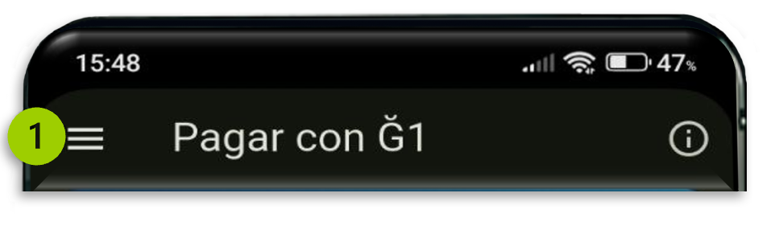
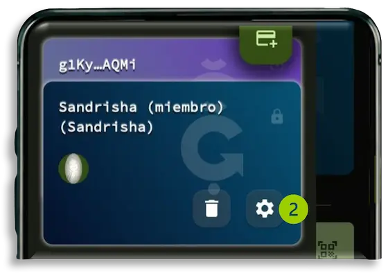
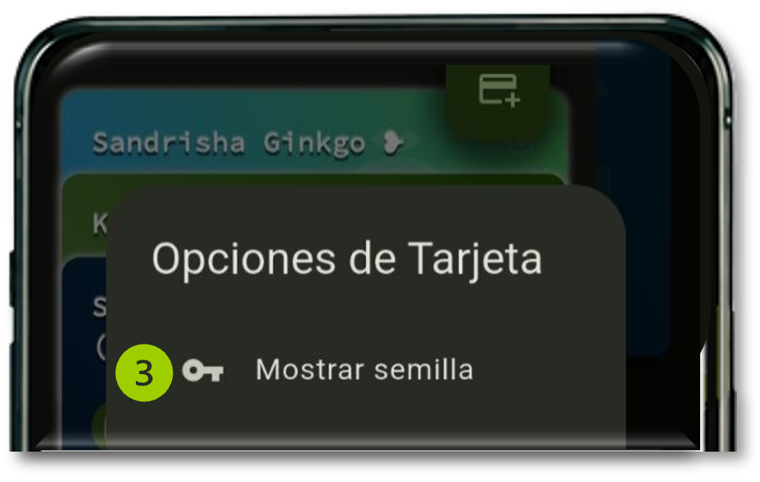
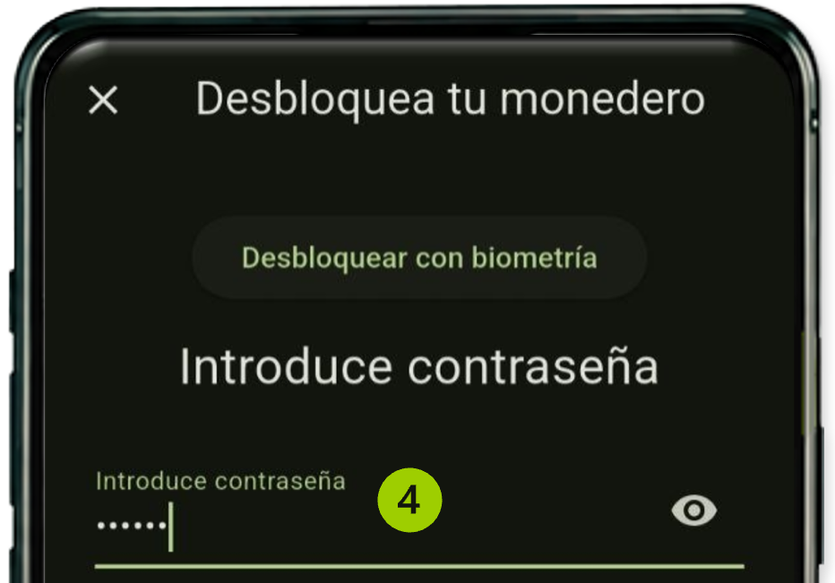
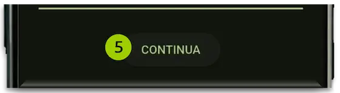
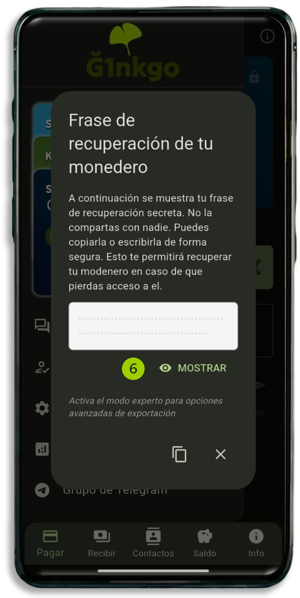

# Guarda tu frase de recuperación

Tu **frase de recuperación** son **12 palabras** que protegen tu monedero. En la app también la verás como **frase semilla** o **semilla**: es lo mismo.

> **Importante:** si pierdes el móvil y no tienes esta frase, no podrás recuperar tus Junas. Nadie puede hacerlo por ti.

## Para qué sirve

Con tu frase de recuperación puedes:

- Recuperar tu monedero si cambias de móvil o lo pierdes.
- Abrir tu monedero en otro dispositivo.

## Cómo guardarla

1. Abre el **menú principal**.

    

2. Pulsa la **rueda dentada** (⚙) que está en la parte de abajo de tu tarjeta.

    

    > **Ojo:** no pulses el icono verde de arriba (añadir cuenta) ni la **papelera**, que borra el monedero.

3. Selecciona **Mostrar semilla**.

    

4. Desbloquea tu monedero con tu **contraseña**, tu **patrón** o la **biometría** (huella).

    

5. Pulsa **Continua**.

    

6. Pulsa **Mostrar**. Aparecerán tus 12 palabras.

    

7. Escríbelas **en papel**, en el mismo orden.

> **Consejo:** haz dos copias y guárdalas en sitios distintos.

¡Listo! Ya tienes tu monedero a salvo.

## Lo que no debes hacer

- No compartas tu frase con nadie, ni con quien diga que te quiere ayudar.
- No la dejes en un lugar donde otras personas puedan verla.

## ¿Prefieres verlo en vídeo?

[Ver este paso en vídeo](https://youtu.be/R94j801BXDQ?t=33)

---

**Siguiente paso:** [Protege tu cuenta](protege-tu-cuenta.md)

¿Ya tenías una cuenta de antes? [Mira esta página](ya-tenia-una-cuenta.md).
